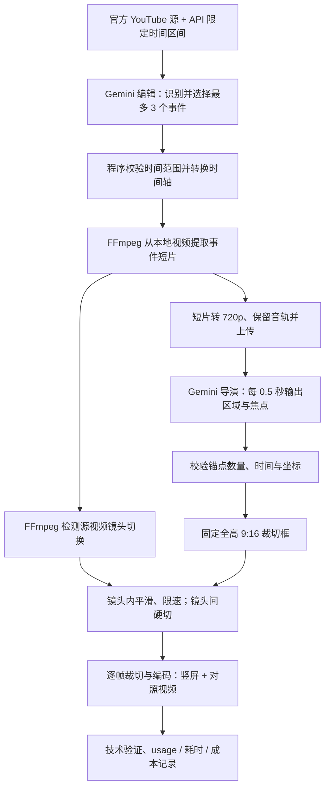

# Gemini 原生视频 baseline（B1）

**实际已完成的这一轮使用 static 模式：两段共 60.5 分钟比赛 → 6 个候选片段，共 156 秒。以下“本次运行流程”描述这一轮结果。脚本另有默认 agentic 配置，但本轮没有完成 agentic 实验。**

## 本次运行流程



### 1. 输入和任务边界

事件发现直接使用官方 YouTube 视频，通过 API 的 `processing.type=static`、`start_offset`、`end_offset` 限定区间；空间裁切和最终渲染使用本地视频。

| 视频 | 完整视频播放区间 | 本地输入长度 | 原始分辨率 |
|---|---|---|---|
| 皇马–巴萨 | 4350–6150 秒 | 1800 秒 | 1280×720 |
| 比利时–日本 | 4200–6030 秒 | 1830 秒 | 1920×1080 |

模型不接收人工指定的人物或高光时间，也没有调用外部比赛资料检索。YouTube 服务端取得的媒体版本未必与本地文件码率相同。此前的大文件上传已放弃，本轮没有把整段本地 MP4 上传成功后用于事件发现。

### 2. Gemini 作为编辑：决定剪哪一段

每场比赛一次请求，输入限定时间范围内的视频和任务提示，要求返回最多 3 个独立事件，每段 5–45 秒，包括铺垫及结果；提示要求合并同一事件的直播与回放，不重复选取。

结构化输出包含：事件类别、起止与峰值时间、事件描述、画面依据、音频依据。事件类别包括进球、乌龙球、重大机会、精彩带球和判罚。

程序检查时间是否越界、峰值是否在区间内、长度是否合法、候选是否重叠。这些是结构与范围检查，**不验证画面中是否真的发生了所述事件**；语义上的直播/回放去重目前也主要依赖提示。

本次每场都选出 3 段，写入 `events.json`。此处仅进行了 2 次正式模型请求。

### 3. 本地工具：切片、对齐时间与准备输入

FFmpeg 按事件区间从本地视频提取短片，转换成 1280×720 并保留音轨，再上传短片供第二阶段理解。最终成片仍从本地源视频裁切，不从这个 720p 分析副本二次裁切。

三个时间轴必须明确区分：

- 完整 YouTube 视频时间：事件发现原始输出所用的时间。
- 本地约 30 分钟视频时间：完整时间减去 4350 或 4200 秒。
- 事件短片时间：第二阶段从 0 秒开始输出锚点，再加事件起点映射回本地视频。

例如皇马–巴萨第一个候选的完整源时间 4875 秒，对应本地 525 秒、事件短片 0 秒。短片 0.5 秒的锚点对应本地 525.5 秒，而非比赛比分牌上的计时。

### 4. Gemini 作为导演：决定画面看哪里

每个事件短片一次独立请求，输入视频、事件描述（作为待核验假设）和完整锚点时间列表，要求每 0.5 秒输出：

| 字段 | 含义 |
|---|---|
| `t_s` | 事件短片内的时间 |
| `shot` | 远景、中景、特写、观众或图文 |
| `region` | 必须保留的动作区域，归一化 `[left, top, right, bottom]` |
| `focus` | 区域过宽时优先保留的点，如球、接球人或人物面部 |
| `focus_description` | 当前关注对象的简述 |
| `uncertain` | 模型是否认为定位不确定 |

模型可以随事件变化从球切换到球门、射门者或庆祝者，没有固定单人物身份。这里输出的是区域与焦点坐标，未使用 Drex 的候选窗口 choice 或栅格边界选择。

六个短片共 6 次请求，合计输出 312 个锚点。每 0.5 秒一个输出锚点是我们要求的计划密度；请求未显式提高服务端采样帧率，**不能据此声称模型确实观察了每 0.5 秒的画面或全部视频帧**。

坐标转换成源视频像素之前，程序检查锚点数量、时间顺序、坐标范围和框边界顺序。若锚点结构校验失败，允许额外一次修复请求。本次六次锚点调用没有触发该修复。

`uncertain` 当前仅被记录，没有自动触发检测器、补帧或恢复模块。所有锚点使用同一固定定位误差参数供公共平滑器处理，不将 Gemini 的自述不确定性当作校准概率。

### 5. 几何与平滑：把稀疏决策变成连续镜头

这一轮强制保持源视频完整高度，裁切框宽度为 `H × 9/16`，实际主要控制水平位置，不做动态变焦。对于 16:9 输入，约保留 31.6% 的横向画面。

程序先根据动作区域选择裁切中心。如果区域过宽，利用 `focus` 偏向关键点，并记录 `too_wide`；没有自动缩成完整横屏留边的回退策略。观众或图文镜头采用居中规则。

FFmpeg 的画面变化分数用于估计镜头边界。每个镜头内部：将锚点目标映射到逐帧时间轴，忽略小幅目标抖动，通过最小二乘路径优化惩罚位置偏差、速度和加速度，再限制移动速度并约束裁切边界。源镜头切换时允许位置重置，不跨不同机位强行平滑。

此处由本地代码执行，没有光流、目标检测、SAM、ReID 或持久对象 ID。平滑器会利用前后锚点，属于离线处理；并不保证关键内容始终在框内，也不能直接用于零前瞻直播。

### 6. 渲染、验证与记录

本地逐帧执行裁切，输出 720×1280 H.264 视频并保留音轨；同时生成源画面与竖屏的对照视频，黄框为模型区域，青框为实际平滑后的裁切框。

自动验证音轨存在、分辨率、时长和完整解码。保存每次请求与响应、逐帧路径、usage、耗时及费用估算。另做助手目视抽查；没有独立人工质量评分，没有自动语义复核 agent 或自动返工环。

## 角色、工具与记忆的实际边界

| 职责 | 当前实现 | 状态 / 记忆 |
|---|---|---|
| 编辑 | Gemini 独立请求，选择事件 | 保存事件 JSON 和证据描述 |
| 导演 | 每段一次 Gemini 独立请求，选择区域与焦点 | 只收到当前短片及事件描述，没有跨短片共享对话记忆 |
| 执行器 | Python、FFmpeg、几何与平滑代码 | 使用当前片段全部锚点和镜头边界生成路径 |
| 检查器 | 程序检查 + 事后助手抽查 | 保存技术检查及观察记录，没有语义错误自动纠正 |

本轮是两阶段模型决策加固定工具执行的 baseline。“编辑”和“导演”是两种调用职责，不是自主调度工具的多 agent 系统。文件缓存用于恢复运行和避免重复调用，不等于事件工作记忆或身份记忆；未调用 Drex、NDI、Whisper、YOLO 或 SAM。

未来若要检验 agent 的价值，需要单独增加证据请求、语义核验、错误恢复与跨阶段记忆，并记录额外调用成本，作为另一个实验版本。

## 本次调用与费用分布

| 阶段 | 调用次数 | 模型 API 估算费用（USD） |
|---|---:|---:|
| 两场比赛的事件发现 | 2 | $0.6002670 |
| 六个短片的裁切锚点 | 6 | $0.4419225 |
| 接口预检 | 1 | $0.0015270 |
| 合计 | 9 | $1.0437165 |

正式运行分别约 241.88 秒和 283.79 秒，两场并行。金额按当日标准付费牌价估算，完整计算口径见 [成本记录](experiments/gemini-baseline-cost-2026-11-14.md)。

此次已发现皇马–巴萨两个候选的时间定位与进球描述不符，原始结果保留。范围与格式合法，不能证明时间语义正确；平滑处理也不能修复上游选错片段的问题。

**版本说明：** 当前公共 `reframe/pipeline.py` 已在本轮之后修改，其 SHA-256 与运行目录 `manifest.json` 中的记录不一致。上述说明依据当次请求、响应、已保存的 `plan.json` 和运行时实现，不把后续平滑器改进归到已生成的六段视频上。重新运行当前代码应使用新的运行名称，作为独立版本比较。

## 运行与复现入口

本地 `.env` 设置 `GEMINI_API_KEY`。脚本从环境变量或该文件读取，不把凭据写入日志。依赖复用项目现有的 Python requests/numpy/Pillow 与 FFmpeg。

```bash
python3 -m reframe.gemini_baseline \
  --video samples/football-keyframes/videos/el-clasico-2017_01h12m30s-01h42m30s.mp4 \
  --name gemini_hydrogen_clasico_v1 --source-offset 4350

python3 -m reframe.gemini_baseline \
  --video samples/football-keyframes/videos/belgium-japan-2018_01h10m00s-01h40m30s.mp4 \
  --name gemini_hydrogen_belgium-japan_v1 --source-offset 4200
```

默认使用 `gemini-4-hydrogen`：完整视频采用 agentic processing 自主选最多 3 个不重复事件，每个最多 45 秒；将选出的短片转为 720p 后，再以 static processing 输出每 0.5 秒的必须保留区域及焦点。默认静态视频采样可能遗漏快速小球动作，0.5 秒输出锚点不代表模型实际观察了每一帧。模型决定事件与关注对象，程序执行镜头切分、固定全高 9:16 裁切和平滑，输出 720×1280 视频及源画面/裁切画面的对照视频。

大文件上传慢时，可以直接输入官方 YouTube 视频的相同时间区间。该接口的区间限制只支持 static 模式；这属于单独的配置，不能与 agentic 混报。2026-11-14 首次实际运行使用：

```bash
python3 -m reframe.gemini_baseline \
  --video samples/football-keyframes/videos/el-clasico-2017_01h12m30s-01h42m30s.mp4 \
  --name gemini_hydrogen_clasico_static_v1 --source-offset 4350 \
  --processing static --youtube-url 'https://www.youtube.com/watch?v=3j_daNHio4o'

python3 -m reframe.gemini_baseline \
  --video samples/football-keyframes/videos/belgium-japan-2018_01h10m00s-01h40m30s.mp4 \
  --name gemini_hydrogen_belgium-japan_static_v1 --source-offset 4200 \
  --processing static --youtube-url 'https://www.youtube.com/watch?v=GrkiZjoyugA'
```

此模式的事件请求要求模型返回完整 YouTube 时间轴，程序再减去 `source-offset`，保存为本地裁剪视频时间。短片空间定位与成片渲染仍使用本地视频。YouTube 服务端取得的码率/分辨率未必等同于本地文件，比较时必须披露。

这是离线产品 baseline；模型与平滑器可以使用未来画面。它不是 Gemini 同构替换 Drex 的 B2，也不代表已经经过人工质量评价。

运行结果在 `runs/<name>/`：

- `manifest.json`：模型、模式、源文件哈希、源视频偏移及代码版本签名。
- `events.json`：模型自行选择的事件、输入片段时间与证据说明。
- `event_XX_vertical.mp4`：竖屏成片，保留音轨。
- `event_XX_debug.mp4`：源画面与竖屏对照；黄框为模型区域、青框为平滑后裁切。
- `event_XX_input.mp4`：空间定位调用所用的短片。
- `event_XX_keyframes.json`、`event_XX_plan.json`：模型锚点与最终逐帧路径。
- `*.request.json`、`*.response.json`、`usage.jsonl`：请求、完整响应、tokens、耗时与失败信息。
- `report.json`：输出文件检查、汇总 usage、按 2026-11-14 标准付费价格估算的模型费用。此项不等于账单，不含本地计算或单独的接口预检费用。

输出时间以裁好的 30 分钟文件开头为零；报告另保存加上 `--source-offset` 后对应的完整比赛时间。事件来自模型，仍需核对，不能作为评测真值。

相同命令可恢复保存的服务端任务与已完成阶段。改变配置或代码时使用新运行名称；网络不明确超时不会自动重复 POST，避免重复计费。`--processing static` 可建立静态视频版本，必须使用不同 `--name`。

验证命令：`python3 -m unittest discover -s tests -p 'test_gemini_baseline.py' -v`。技术验证包含坐标/时间合法性、音轨、时长、分辨率及成片完整解码；这些检查不证明构图质量。

接口依据：[视频](https://aistudio.google.com/docs/video-understanding)、[结构化输出](https://aistudio.google.com/docs/structured-output)、[Files API](https://aistudio.google.com/docs/files)、[价格](https://aistudio.google.com/docs/pricing#gemini-4-hydrogen)。
