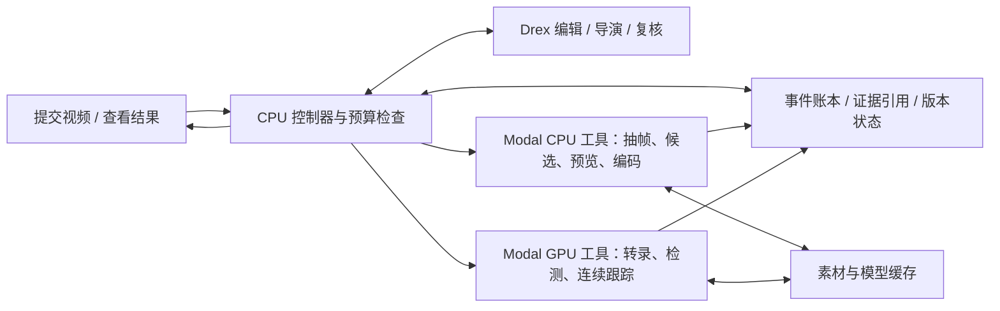

# Reframe Guard：结合 Modal 的足球竖屏 agent 设计

日期：2026-11-14。本文将 Modal 理解为 modal.com 云计算平台。状态：架构提案；仅调研官方资料，没有部署 Modal、上传凭据或调用付费云任务。

## 建议聚焦的产品场景

从约 30 分钟连续足球转播中，自行找到 3 段值得观看的进攻/射门片段，输出 20–45 秒竖屏视频。系统能够发现“事件时间不对”“球暂时看不清”“裁切漏掉关键动作”，补充证据或定位后再交付；证据仍不足时明确拒绝该候选，并继续搜索。

主决策模型保留 Drex；NDI 或 Whisper 提供解说转录；Modal 提供 CPU 工具执行、按需 GPU 感知、素材存储和任务管理。定位不是固定追同一个球员：关注对象随推进、传球、射门、庆祝变化。

设计目标不是简单上云。需要实验证明：带证据核验和按需恢复的 agent，在保留关键动作、观看舒适度与交付率相当时，能否改善总成本或耗时。

## 从当前 baseline 出发

当前 Gemini baseline 已生成 6 个候选片段，但皇马–巴萨其中两个时间定位与进球描述不符；格式与数值范围检查未能发现语义错误。`uncertain` 只被记录，没有触发额外观察；事件与导演是固定调用，没有返工闭环。完整记录见 [baseline 说明](../gemini-baseline.md) 与 [成本记录](../experiments/gemini-baseline-cost-2026-11-14.md)。

Modal 能帮助执行补看、检测、跟踪和渲染，但不会自动解决上述判断错误。云计算节省与 agent 判断收益必须拆开测量。

## Modal 哪些已有方案可以借鉴

| 官方能力 / 示例 | 对本项目的复用 | 不能据此声称的能力 |
|---|---|---|
| [Whisper 动态批处理](https://modal.com/docs/examples/batched_whisper) | GPU 转录解说，缓存相同素材的转录结果 | 示例吞吐率不等于足球解说表现；词/段时间戳需配置和对齐 |
| [YOLO + WebRTC](https://modal.com/docs/examples/webrtc_yolo) | GPU 视频观察器；后续接实时预览 | 摄像头检测 demo 不等于足球小球跟踪或直播裁切已解决 |
| [异步 OCR 任务示例](https://modal.com/docs/examples/doc_ocr_jobs) / [Job processing](https://modal.com/docs/guide/job-queue) | 提交任务返回 job ID，后台处理并查询结果；迁移成视频任务 | `spawn` 不自动提供业务级 exactly-once、多阶段事务或 agent 记忆 |
| [LangGraph + Sandbox](https://modal.com/docs/examples/agent) | 未来 agent 需要生成并执行新分析代码时的隔离环境 | 现有 FFmpeg/检测工具不需要为了称为 agent 就放进 Sandbox |
| [Volumes](https://modal.com/docs/guide/volumes) | 视频、分析副本、模型权重、预览与不可变证据文件复用 | 同一 JSON 文件的多写者事务、全局锁、可靠身份记忆 |

更详细的部署约束见 [Modal 能力核验](modal-capabilities-2026-11-14.md)。本阶段优先使用预先注册的 Functions/Classes；任意代码执行 Sandbox 作为后续可选能力。

## 角色分工：三个决策职责，一个确定性调度器

角色可以共享 Drex 模型，区别在输入上下文、可选动作与记忆权限；不要求三个模型服务或三个常驻 GPU。

| 角色 | 它要解决的问题 | 能主动选择的动作 | 记忆 |
|---|---|---|---|
| 事件编辑 | 这是不是值得剪的事件？时间与描述是否一致？ | 确认/拒绝候选；读取附近解说；加密抽帧；扩大搜索范围；选择起止边界候选 | 事件假设、证据、直播/回放关系、已拒绝区间和原因 |
| 构图导演 | 现在应该展示什么？现有候选是否足够？ | 选择裁切窗口；保持；补看动作；请求检测；请求连续跟踪；改变关注对象 | 当前镜头、事件阶段、关注区域、参考图、上一裁切位置与速度、最后可靠观察 |
| 成片复核 | 关键动作和事件结果是否保留？转场是否合理？ | 通过；要求重新定位事件；要求重规划局部裁切；拒绝交付 | 关键时刻清单、缺失证据、失败位置、修订历史 |
| 调度器（普通代码） | 这个动作是否合法、还剩多少预算、结果写到哪里？ | 校验工具参数、预留预算、执行/恢复任务、更新状态、到限停止 | 任务状态、调用账本、预算、模型/工具版本、幂等标识 |

复核不能只读导演的文字总结。它必须对照新抽取的源帧与输出帧，结合明确的事件要求检查。比分牌 OCR 变化和解说只能作为证据：比分牌可能延迟、VAR 可能推翻进球，不能机械地以短窗口内比分不变否决所有进球。

## Agent 如何使用 Drex 调工具

Drex 的已核验接口是 `choice` / `noul` / `score`，不应假设它能像通用聊天模型一样任意生成函数调用。由程序为每一步生成**当前可用的动作菜单与参数候选**，Drex 返回选项，调度器映射到已注册工具。[接口核验](soccer-reframe-api.md)。

以下是项目内部表示，非 Modal 或 Drex 原生返回类型：

```json
{
  "state_version": 17,
  "event_id": "E03",
  "shot_id": "S18",
  "choices": {
    "A": {"tool": "accept_crop", "candidate_id": "C2"},
    "B": {"tool": "inspect_span", "span_id": "S18_dense_02"},
    "C": {"tool": "detect_objects", "frame_set_id": "S18_recovery_02"},
    "D": {"tool": "track_span", "span_id": "S18_tail", "seed_id": "obs_162"},
    "E": {"tool": "abstain", "reason_code": "insufficient_evidence"}
  }
}
```

调度器仅接受本状态版本中已有的候选和证据 ID。超过预算的动作不放入菜单；预估与实际成本分别记录。模型置信度是一个观察信号，不直接等同于正确率或触发全部昂贵操作。

事件起止和裁切坐标都由程序维护：模型选择候选 ID，而不是自由填写时间或未经约束的坐标。时间线以源视频 PTS 为准；每个抽帧记录 source PTS、local clip offset 和可用时间。画面外边栏可显示准确源时间，比分牌 OCR 放在独立字段。这能减少时间混淆，但不能保证模型选中的事件语义正确。

## 具体的 Modal 工具层

以下名称为拟实现工具，不是 Modal 自带 API。

| 工具 | 资源与输入 | 输出及调用时机 |
|---|---|---|
| `ingest_and_index` | CPU；用户视频/已可访问的媒体源 | 内容哈希、帧时间索引、镜头边界、低码率分析副本、音轨；同一素材一次入库 |
| `transcribe` | NDI 外部 API，或 Modal GPU 上的 Whisper 二选一 | 带源时间的解说片段；按素材与模型版本缓存，不默认运行两套 |
| `inspect_span` | CPU；已知时间区间和采样配置 | 加密抽帧、相邻上下文、可选比分牌 OCR；用于证据不足 |
| `propose_crops` | CPU；当前全景、上一裁切、运动估计 | 已知坐标的多个候选窗口；首个镜头从横向覆盖候选开始，无需人工点人 |
| `detect_objects` | GPU；少量帧或短窗口 | 球/球员框与置信度；定位失败时调用，先验证足球小球召回 |
| `track_span` | GPU；连续片段与已知初始化观察 | 轨迹、丢失标记、恢复信息；整段连续处理以保留跨帧状态 |
| `preview_crop` | CPU；视频引用和路径版本 | 小尺寸预览与关键帧对照，供复核角色查看 |
| `render_final` | CPU 起步；审核通过的路径 | 保留音轨的正式视频、debug 视频；多事件可并行，编码加速另行测量 |

YOLO＋常规关联器先作为恢复工具，SAM 3.1 后续作为强视觉替代；权重访问、CUDA 环境、显存和推理速度需实测，不能仅凭“能用 GPU”就承诺可部署。

对 Drex，每次组图必须遵守已核验的最多 8 张图片和请求大小约束。导演输入初值可为“3 张时间上下文 + 4 张候选裁切 + 1 张参考图”；角色所需信息不同，组图不必统一。没有足够视觉证据时，选择补看而非把同一张模糊小球图反复提交。

## 一次真实决策闭环会怎样发生

以下是待实现行为示例，不是已有实验结果：

1. 索引工具根据音量/解说、镜头变化和周期性视觉覆盖产生候选。不能只依赖解说高音，否则可能漏掉安静的精彩带球。
2. 编辑收到候选 ID 和证据，选择“需要补看”。Modal 在对应时间区间抽更密的帧；编辑随后确认事件，或扩大搜索/拒绝候选。
3. 导演在推进阶段选择一个覆盖持球区域的裁切窗口，保存关注对象和运动方向。程序用轻量运动估计与控制器填补决策间隔。
4. 长传发生后，候选都可能漏掉接球方向。导演选择“检测”，Modal GPU 仅分析该困难窗口。返回新观察后，程序生成新的候选，导演再选择。
5. 射门完成，事件阶段从进攻变为结果/庆祝。导演可以换焦点，但必须遵守镜头内的移动约束和切镜规则。
6. 复核在射门、球越过门线、庆祝切换等证据时刻对照源帧与输出；若漏关键内容，仅重做相关窗口。若发现事件本身不符，退回编辑重新定位。
7. 若预算耗尽仍不能交付，记录失败并返回未确认状态；不能将未经核验的成片标记为通过。

这是“观察—决策—调用工具—更新记忆—再决策”的闭环。具体路径由每次观察结果决定，普通片段可以跳过 GPU 恢复。

## 记忆设计与存储

| 记忆层 | 内容 | 生命周期与更新规则 |
|---|---|---|
| 素材证据 | 视频哈希、PTS、镜头、转录、帧/裁切引用、观察来源 | 不可变、按版本追加；源帧事实与模型推测分开 |
| 事件账本 | 假设、证据 ID、确认/拒绝状态、重复事件关系 | 跨镜头保留；新证据可以推翻假设，不能把模型描述写成确定真值 |
| 导演工作状态 | 镜头内参考图、关注区域、轨迹、裁切速度、观察新鲜度 | 切镜清空坐标和速度；关注对象改变则更新参考；失踪信息带过期时间 |
| 执行与成本账本 | 工具请求 ID、状态版本、输入签名、预算预留、结果、实际耗时与费用 | 每次动作提交前后记录；失败与重试也保存 |

视频和模型权重适合放 Modal Volume 或对象存储。MVP 采用每个 job 一个控制器写状态，worker 只写自己的结果文件；控制器读取新结果后统一提交下一版状态。正式多写者场景使用支持事务的数据库，避免把同一个 Volume JSON 文件当作共享数据库。[Volume 一致性限制](https://modal.com/docs/guide/volumes#filesystem-consistency)。

一个 GPU Class 可缓存模型权重，但**容器内权重缓存不等于某场比赛的跟踪记忆**。相邻请求可能落在不同容器。MVP 让一次 `track_span` 在单个调用内完成一个短连续窗口；跨调用恢复要显式传递检查点或重新初始化，不假设自动保持 tracker 状态。

## Modal 部署与调度原则



- 用 CPU 控制器等待外部 Drex/NDI 请求，不让分配了 GPU 的函数在等外部 API 时占着卡。长任务可通过 `spawn` 提交并查询；多段独立预览/渲染可用 `map`，模型决策、预算和写状态保持正确依赖关系。[Job processing](https://modal.com/docs/guide/job-queue)。
- 连续帧尽量在一次工具调用内批量处理，避免每帧都付出调度、序列化和冷启动代价。球跟踪的前后帧依赖不能通过任意乱序并行消除。
- 起步 GPU 工具 `min_containers=0`，`max_containers` 限制为较小值；是否保活由实测延时决定。GPU 模型加载和保活尾部要计费，不能认为 scale-to-zero 意味着每次困难帧只有纯推理成本。[自动扩缩容](https://modal.com/docs/guide/scale)、[冷启动](https://modal.com/docs/guide/cold-start)。
- 固定工具使用 Functions；只有 agent 确实需要编写新分析代码时才考虑 Sandbox。隔离执行环境本身不会产生规划、记忆或复核能力。
- 为每次工具调用生成输入签名及 request ID；保存 Modal call ID 和外部模型 request ID。工具失败可以按类型重试，外部模型未知结果的请求不能盲目重放，否则可能重复付费。Modal 的容器重调度不等同于业务 exactly-once。[重试说明](https://modal.com/docs/guide/retries)。
- 云端读取已经可访问的素材，或将用户本地视频上传一次后复用。上云不能消除用户首次上传的带宽瓶颈；Drex 只接收当前需要的图像包，而非反复传完整视频。

## 成本与实验：先区分架构收益和模型收益

当前约 $1.0437 只包含 Gemini 模型费用估算。下一版应记录：模型 API、转录、GPU 分配/运行/保活、CPU 与内存、视频预处理/渲染、存储、网络及失败重试。冷启动、热启动分别测；字幕/OCR/检测缓存不能作为免费服务隐藏。[Modal 计费](https://modal.com/docs/guide/billing)、[价格](https://modal.com/pricing)。

所有动作记录 `job_id / event_id / shot_id / role / action / evidence_ids / state_version / predicted_cost / actual_usage / elapsed / retry / outcome`。预算由程序控制，建议最小实验给每个短片有限的补看、恢复和修订次数；具体限额在开发集固定。金额预留只是估计，还需结合模型输出上限、并发上限和实际账单，不能当作绝对美元硬上限。

优先比较以下配置：

| 配置 | 用途 |
|---|---|
| 已有本地 Gemini baseline | 保存现有表现和错误，作为历史参照 |
| 相同固定流程迁移 Modal 工具 | 测素材复用、云端并行与资源成本；不更换决策模型 |
| 同一工具集 + 简单规则触发补看/恢复 | 测调度机制本身是否足够 |
| 同一工具集 + Drex 角色决策与复核 | 测 agent 决策、记忆和返工的增益 |
| Gemini 替换 Drex 的同构角色决策（可选） | 隔离决策模型的贡献 |

参数与代码版本冻结，共用相同裁切控制器。两个时间错误作为回归用例，但不能只看能否拒绝错误：还要看正确事件召回、最终交付率、关键动作保留、观看稳定度与全成本。现有两场已经被查看和调试，不能宣称是未见盲测；最终扩展第三场比赛。

## 建议的第一版落地范围

1. 迁移 CPU 素材索引、抽帧、预览/渲染工具，建立统一源时间与候选 ID；用现有六个候选验证工具和记忆日志。
2. 加入编辑/复核的证据请求闭环，先解决“时间合法但事件不对”。复核未通过可以返回编辑扩大搜索，不能只输出少一些片段来提高表面正确率。
3. 加入一个 GPU 检测/连续跟踪恢复工具，比较规则和 Drex 何时调用；先用 YOLO 路线，再按需要替换 SAM。
4. 完成成本与质量对照后再做直播。直播使用已到达帧、环形缓冲与因果控制器，单独测冷启动/网络/模型响应造成的总延时；Modal WebRTC 示例可以提供传输和预览起点，不能保证当前离线 agent 满足实时要求。

最小演示应展示一次可解释的修复：哪个候选不可靠、agent 请求了什么新证据、Modal 执行了哪个工具、记忆如何更新、画面如何改善，以及为此增加了多少成本。该演示仍需实际实现和验证。
